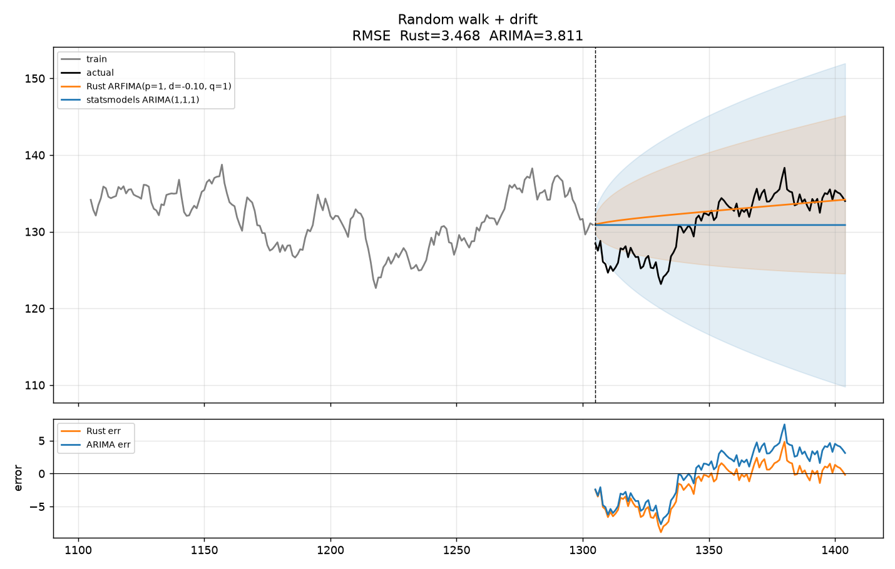
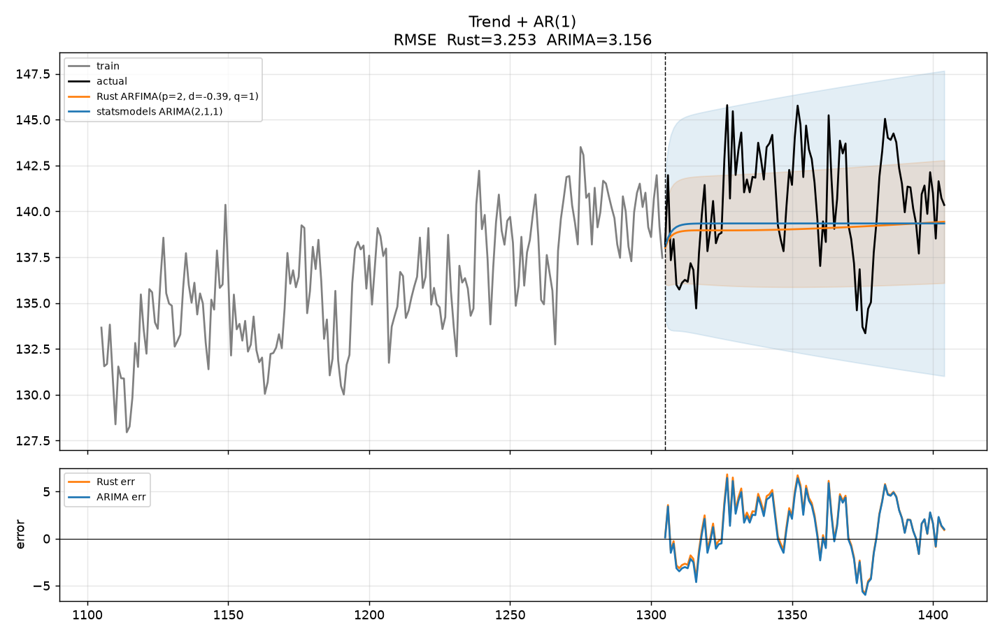
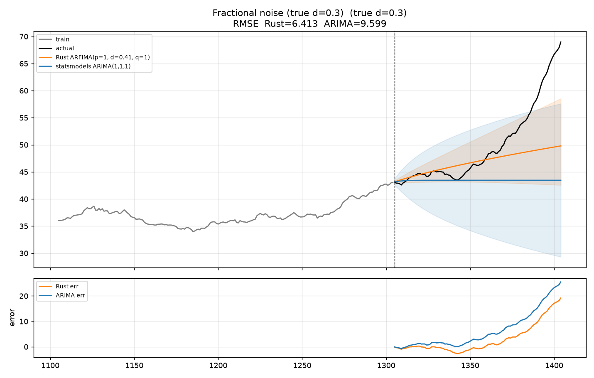
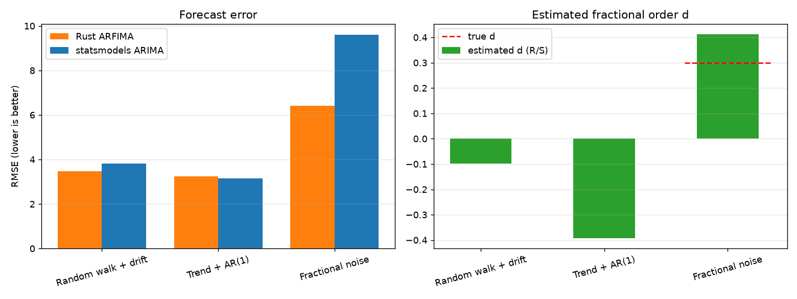

# ⚡ ARFIMA-RS: Long-Memory Time Series & Market Regime Engine

> [!CAUTION]
> **DEPRECATED:** `rsapp` is deprecated and no longer maintained. It will not receive updates or bug fixes. Do not use it in new projects.

A modular, zero-panic Rust workspace delivering **Auto-Regressive Fractionally Integrated Moving Average (ARFIMA)** modeling, **Rescaled Range (R/S) Hurst Exponent Analysis**, and **Seasonal Hybrid ESD (S-H-ESD) Anomaly Detection**, exposed directly to Python via native PyO3 extensions.

Designed for high-frequency financial time series, crypto market regime detection, and quantitative risk modeling.

---

## 📑 Table of Contents
- [Architecture & Mathematical Pipeline](#-architecture--mathematical-pipeline)
- [Crates Overview](#-crates-overview)
- [Key Features](#-key-features)
- [Quickstart & Installation](#-quickstart--installation)
- [`arfima_model` API Reference](#-arfima_model-api-reference)
- [Validation vs. statsmodels ARIMA](#-validation-vs-statsmodels-arima)
- [Mathematical Deep-Dive](#-mathematical-deep-dive)
- [License](#-license)

---

## 🧠 Architecture & Mathematical Pipeline

The modeling engine strictly unwinds non-linear forward and reverse transformations in a mathematically sound **LIFO** order:

```
                  ┌────────────────────────────────────────────────────────┐
                  │                 Raw Price Series (P_t)                 │
                  └──────────────────────────┬─────────────────────────────┘
                                             │
                                             ▼
                               ┌───────────────────────────┐
                               │  S-H-ESD Anomaly Cleanup  │  (Median / MAD Decomposition)
                               └─────────────┬─────────────┘
                                             │
                                             ▼
                               ┌───────────────────────────┐
                               │     Box-Cox Transform     │  (Brent's MLE Optimization: y -> x)
                               └─────────────┬─────────────┘
                                             │
                                             ▼
                               ┌───────────────────────────┐
                               │     Z-Score Whitening     │  (Standardization: x -> z)
                               └─────────────┬─────────────┘
                                             │
                                             ▼
                               ┌───────────────────────────┐
                               │    R/S Hurst Analysis     │  (Memory parameter: d = H - 0.5)
                               └─────────────┬─────────────┘
                                             │
                                             ▼
                               ┌───────────────────────────┐
                               │ Fractional Differencing   │  (Binomial Filter: (1 - L)^d)
                               └─────────────┬─────────────┘
                                             │
                                             ▼
                               ┌───────────────────────────┐
                               │      PACF / ACF Order     │  (Durbin-Levinson Lag Selection)
                               └─────────────┬─────────────┘
                                             │
                                             ▼
                               ┌───────────────────────────┐
                               │   ARMA(p, q) Optimizer    │  (L-BFGS with AIC / AICc / BIC)
                               └─────────────┬─────────────┘
                                             │
                                             ▼
                        ┌───────────────────────────────────────────┐
                        │ Recursive Multi-Step Forecast & CI Funnel │
                        └────────────────────┬──────────────────────┘
                                             │
             ┌───────────────────────────────┴───────────────────────────────┐
             │ Reverse Inversion: (RevFracDiff -> RevZScore -> RevBoxCox)    │
             ▼                                                               ▼
┌─────────────────────────┐                                     ┌─────────────────────────┐
│     Point Forecasts     │                                     │ Dynamic Confidence Band │
└─────────────────────────┘                                     └─────────────────────────┘
```

---

## 📦 Crates Overview

The workspace is modularized into 10 decoupled, high-performance crates:

| Crate | Purpose | Core Algorithm / Technique |
| :--- | :--- | :--- |
| [`arfima_model`](rs_workspace/arfima_model) | Top-level PyO3 orchestrator | Maturin C-extension, Python bindings |
| [`frac-integration`](rs_workspace/frac-integration) | Fractional calculus | Causal expanding-window $(1 - L)^d$ convolution |
| [`box-cox`](rs_workspace/box-cox) | Power transformation | Profile log-likelihood maximization via Brent's method |
| [`rs-analysis`](rs_workspace/rs-analysis) | Long-memory estimation | Rescaled Range (R/S) Hurst exponent regression ($H$) |
| [`s-h-esd`](rs_workspace/s-h-esd) | Robust anomaly filtering | Seasonal Hybrid Extreme Studentized Deviate with Bonferroni correction |
| [`pacf-acf`](rs_workspace/pacf-acf) | Model identification | Durbin-Levinson recursion & sample autocorrelation |
| [`arma`](rs_workspace/arma) | Stationarity estimation | Quasi-Newton L-BFGS with Armijo line search |
| [`forecast`](rs_workspace/forecast) | Horizon projection | ARMA recursive forward simulation with past innovation tracking |
| [`confidence-intervals`](rs_workspace/confidence-intervals) | Dynamic error funnels | ARFIMA impulse response $\Psi(L) = (1 - L)^{-d} \frac{\Theta(L)}{\Phi(L)}$ |
| [`utils`](rs_workspace/utils) | Foundational math | Zero-allocation moments, autocovariance, NaN-safe median |

---

## ✨ Key Features

- **Panic-Resistant Sorting:** Uses `f64::total_cmp` instead of `partial_cmp().unwrap()` on floating-point numbers, so NaNs in malformed data don't crash the sort.
- **Length-Preserving Causal Filters:** Fractional differentiation uses expanding-window memory convolution so that $N$ input points always yield exactly $N$ filtered points.
- **Strict Inversion Composition:** Forecasts and impulse-response confidence bounds respect monotonic transformations:
  $$\hat{Y} = \text{RevBoxCox}\Big(\text{RevZScore}\big(\text{RevFracDiff}(\hat{W})\big)\Big)$$
- **Memory Efficient:** Allocation-conscious Rust loops avoid intermediate vector duplication.
- **PyO3 & NumPy Interoperability:** Python bindings accept NumPy arrays.

---

## 🚀 Quickstart & Installation

### 1. Requirements
- **Rust Toolchain:** stable `>= 1.80` ([rustup.rs](https://rustup.rs/))
- **Python:** `3.10+` (Recommended: `3.12+`)
- **Virtual Environment Tool:** `uv` or standard `python3 -m venv`

### 2. Build and Install via Maturin

```bash
# 1. Clone the repository
git clone https://github.com/tenseurevyeux/RS-analysis.git
cd RS-analysis

# 2. Create and activate a Python virtual environment
python3 -m venv .venv
source .venv/bin/activate

# 3. Install build tools
pip install maturin numpy scikit-learn matplotlib

# 4. Compile and install the Rust extension in release mode
cd rs_workspace/arfima_model
maturin develop --release
```

### 3. Quick Start

```python
import json
import numpy as np
from arfima_model import arfima as ARFIMA


with open("price_series.json") as f:
    series = np.array(json.load(f))

split_size = 0.87
horizon = 100
cut = int(len(series) * split_size)
train, test = series[:cut], series[cut:]

model = ARFIMA(
    7,      # freq: seasonal period used by the S-H-ESD anomaly filter
    0.05,   # alpha: significance level of the ESD test
    0.499,  # ub: max fraction of points flagged as anomalies
    True,   # hybrid: use median/MAD (robust) statistics
    200,    # max_box_cox_iters
    50,     # min_window: smallest R/S sub-period
    2000,   # rs_iters: number of R/S window sizes (n_points)
    20,     # nlags: lags inspected in ACF/PACF for order selection
    50,     # max_iters_optim: L-BFGS iterations per (p, q) candidate
    "aic",  # optimizer: information criterion ("aic", "aic_c", "bic")
)

model.fit(train)
p, d, q = model.get_params()
print(f"Selected ARFIMA(p={int(p)}, d={d:.3f}, q={int(q)})")

preds = model.forecast(train, horizon)
lower, upper = model.confidence_intervals(list(preds), horizon, None, 0.95)
```

The full script, including data download and plotting, is in
[`debug/src/debug/main.py`](debug/src/debug/main.py).

---

## 📖 `arfima_model` API Reference

Source: [`rs_workspace/arfima_model/src/lib.rs`](rs_workspace/arfima_model/src/lib.rs).
The crate exposes a single Python class, `ARFIMA`, from the module `arfima_model`.

```python
from arfima_model import ARFIMA
```

All errors are raised as `ValueError`.

### Constructor

#### `ARFIMA(freq, alpha, ub, hybrid, max_iter_box_cox, min_window, n_points, nlags, max_iters_optim, optimizer)`

Creates an unfitted model. Nothing is computed until `fit()` is called.

| Parameter | Type | Description |
| :--- | :--- | :--- |
| `freq` | `int` | Seasonal period used by the S-H-ESD anomaly filter |
| `alpha` | `float \| None` | Significance level of the ESD test |
| `ub` | `float \| None` | Upper bound on the fraction of points that can be flagged as anomalies |
| `hybrid` | `bool \| None` | Use robust median/MAD statistics in S-H-ESD |
| `max_iter_box_cox` | `int` | Max iterations for the Box-Cox lambda search |
| `min_window` | `int` | Smallest sub-period length in the R/S analysis |
| `n_points` | `int` | Number of window sizes used in the R/S regression |
| `nlags` | `int` | Number of lags inspected in ACF/PACF when choosing `p` and `q` |
| `max_iters_optim` | `int` | L-BFGS iterations per `(p, q)` candidate |
| `optimizer` | `str` | Information criterion for model selection: `"aic"`, `"aic_c"` or `"bic"` |

### Methods

#### `fit(input: list[float]) -> None`

Estimates the model from a price series. Steps:

1. Detects anomalies with S-H-ESD and repairs them.
2. Finds the Box-Cox `lambda` and transforms the data.
3. Z-scores the data and takes first differences (returns).
4. Estimates the Hurst exponent with R/S and sets `d = H - 0.5`, clamped to `[-0.499, 0.499]`.
5. Applies the fractional difference `(1 - L)^d`.
6. Picks initial `p` and `q` from significant PACF/ACF lags (threshold `1.96 / sqrt(n)`), then optimizes the ARMA model.
7. Estimates the innovation noise variance.

Stores `mean`, `std_dev`, `lambda`, `noise`, `p`, `d`, `q` and `psi`.
Raises `ValueError` if the input is empty, the series has zero variance after Box-Cox, or any step fails.

#### `forecast(data: list[float], horizon: int) -> numpy.ndarray`

Forecasts `horizon` steps ahead from `data`, which is usually the training series.
Applies the stored Box-Cox and z-score, differences and fractionally differences the data, forecasts with the ARMA model, then inverts the transforms in reverse order. Returns a 1-D `float64` array of length `horizon` in the original price scale.
Raises `ValueError` if the model is not fitted, `data` has fewer than 2 points, or a transform fails (for example Box-Cox on non-positive values).

#### `confidence_intervals(preds: list[float], horizon: int, epsilon: float | None, quantile: float) -> tuple[list[float], list[float]]`

Builds a confidence band around forecasts. Uses the ARFIMA impulse response with the cumulative sum of its weights and the estimated noise standard deviation. The bounds are computed in z-score space and mapped back to the price scale.

| Parameter | Description |
| :--- | :--- |
| `preds` | Forecasts returned by `forecast()`, in price scale. Must not be empty |
| `horizon` | Number of steps for the impulse response. The larger of `horizon` and `len(preds)` is used |
| `epsilon` | **Currently ignored.** Pass `None` |
| `quantile` | Quantile passed to the interval calculation, for example `0.95` |

Returns `(lower, upper)`. Raises `ValueError` if the model is not fitted or `preds` is empty.

#### Getters

All getters require nothing but a constructed model, and return default values (`0`) before `fit()`.

| Method | Returns | Description |
| :--- | :--- | :--- |
| `get_mean()` | `float` | Mean of the Box-Cox-transformed training data, used for z-scoring |
| `get_std_dev()` | `float` | Standard deviation used for z-scoring |
| `get_lambda()` | `float` | Fitted Box-Cox lambda |
| `get_noise()` | `float` | Estimated innovation variance |
| `get_params()` | `numpy.ndarray` | `[p, d, q]` as floats |
| `get_psi()` | `numpy.ndarray` | Fitted ARMA coefficients: `psi[0]` is the constant, `psi[1..=p]` are the AR terms (`phi`), and `psi[p+1..]` are the MA terms (`theta`). Empty before `fit()` |

---

## 📊 Validation vs. statsmodels ARIMA

All comparison tests live in
[`debug/src/debug/comp.py`](debug/src/debug/comp.py). Run it with:

```bash
cd debug/src/debug
python comp.py
```

### What `comp.py` does

| Function | Role |
| :--- | :--- |
| `make_series()` | Builds three strictly positive synthetic series with known structure |
| `frac_integrated()` | Simulates ARFIMA(0, d, 0) noise via MA(∞) weights of $(1-L)^{-d}$ |
| `run_case()` | Fits the Rust model, then fits `ARIMA(p, 1, q)` with the **same** `p`, `q`, forecasts `HORIZON` steps and plots both |
| `metrics()` | MAE, RMSE and MAPE on the hold-out window |
| `summary_plot()` | Bar charts of RMSE and estimated `d` across all cases |
| `check()` | Sanity assertions: `d` in (-0.5, 0.5) and forecasts are finite |

Each series is split 87% train / 13% test. Both models forecast the same
horizon, and both show a 95% interval.

### Case 1: Random walk with drift



A pure random walk with drift has no long memory, so the estimated `d` should
stay near zero. This case checks that the R/S step doesn't invent persistence.
On a series like this the two forecasts should be close to each other. A large
gap would point to a problem in the fractional-differencing or inversion step.

### Case 2: Trend + AR(1)



A linear trend with short-memory AR(1) noise. This is the case where
`ARIMA(p, 1, q)` is a good fit, so statsmodels is a strong baseline. It shows
whether the Rust pipeline (Box-Cox, z-score, fractional differencing and ARMA)
loses accuracy on a series with no true long memory. Compare how well each
model follows the slope, and how wide each interval is.

### Case 3: Fractional noise (true d = 0.3)



The series is `100 * exp(0.005 * cumsum(ARFIMA(0, 0.3, 0)))`, so it is
positive and has known long memory. This is the case where fractional
differencing should help. Compare the estimated `d` with the true value 0.3
(see the summary chart). R/S estimators are noisy and biased on finite samples,
so expect only a rough match.

### Summary



- **Left:** hold-out RMSE for the Rust ARFIMA model and statsmodels ARIMA on
  each case (lower is better).
- **Right:** the `d` estimated by R/S for each case. The red dashed line marks
  the true `d` where one is known.

> **Note:** `statsmodels` uses `d = 1`, while the Rust model estimates a
> fractional `d` from R/S, so the two are not the same model. The
> comparison tests the fractional step and the fitting method. It doesn't prove
> that either model is better in general. The series are synthetic and the
> results come from a single random seed.

---


## 📐 Mathematical Deep-Dive

### 1. Rescaled Range (R/S) Hurst Exponent ($H$)
For sub-periods of length $\tau$, the rescaled range is computed on increments:
$$\left(R/S\right)_\tau = \frac{\max_{1 \le t \le \tau} \sum_{i=1}^t (X_i - \bar{X}) - \min_{1 \le t \le \tau} \sum_{i=1}^t (X_i - \bar{X})}{\sqrt{\frac{1}{\tau} \sum_{i=1}^\tau (X_i - \bar{X})^2}}$$

The Hurst exponent $H$ is estimated by OLS linear regression:
$$\log\left(R/S\right)_\tau = c + H \log(\tau)$$
* **$H = 0.5$:** Standard Brownian motion (Random Walk, memoryless).
* **$H > 0.5$:** Persistent / trending regime (long memory).
* **$H < 0.5$:** Anti-persistent / mean-reverting regime.

The fractional integration parameter is derived as:
$$d = H - 0.5$$

### 2. Fractional Differencing Operator
The continuous memory binomial filter $(1 - L)^d$ is expanded as:
$$(1 - L)^d = \sum_{k=0}^{\infty} w_k L^k, \quad w_0 = 1, \quad w_k = -w_{k-1} \frac{d - k + 1}{k}$$

### 3. ARFIMA Impulse Response & Forecast Variance
The moving-average Wold decomposition of the integrated series is:
$$\Psi(L) = (1 - L)^{-d} \frac{\Theta(L)}{\Phi(L)} = \sum_{j=0}^{\infty} \psi_j L^j$$

The $h$-step-ahead forecast error variance expands monotonically as:
$$\sigma^2(h) = \sigma_\epsilon^2 \sum_{j=0}^{h-1} \psi_j^2$$
providing statistically sound, non-collapsing prediction envelopes.

## 📄 License
MIT. Note: no `LICENSE` file is currently in the repository; add one before relying on this.
